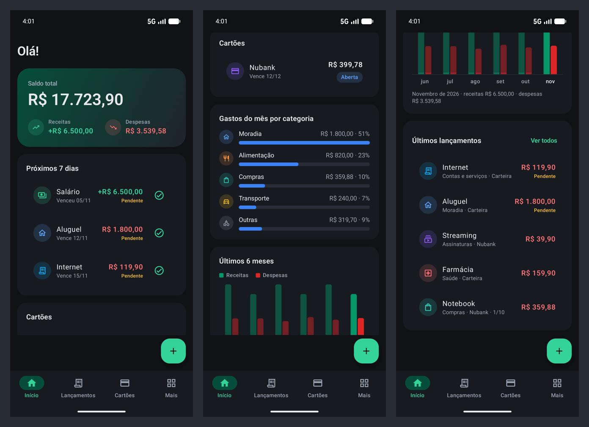
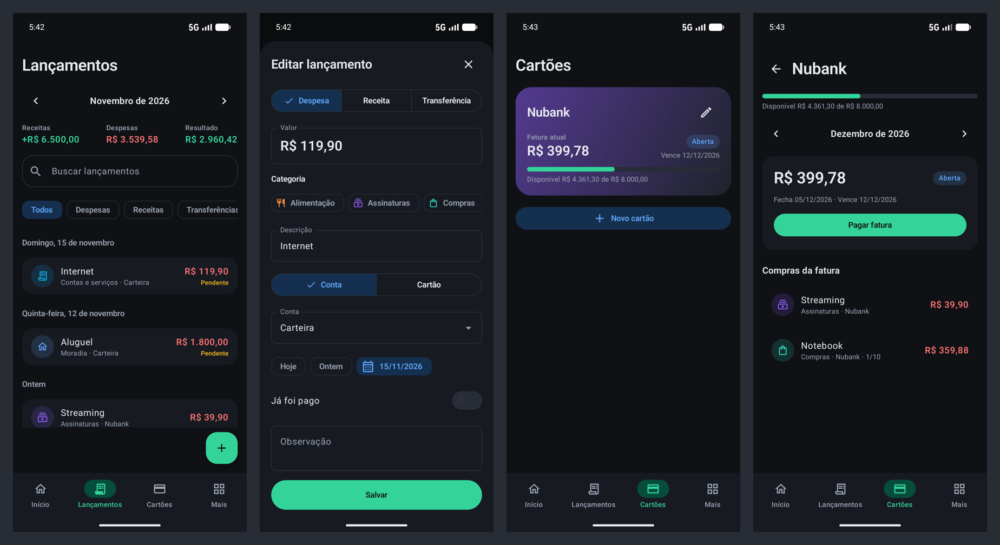
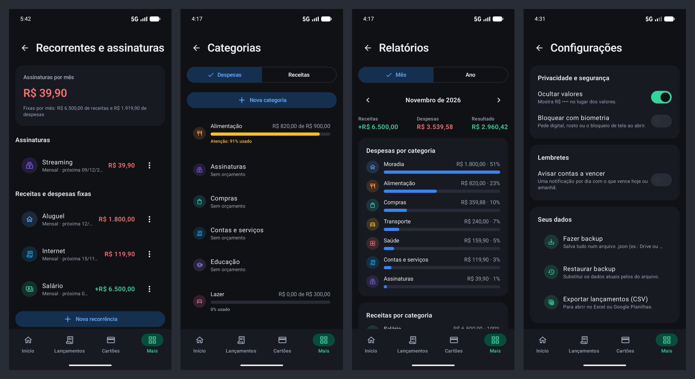

# Finanças — app Android de finanças pessoais

App Android para controlar o dinheiro do dia a dia: receitas e despesas, cartão de
crédito com faturas e parcelas, contas recorrentes e assinaturas, orçamentos por
categoria e relatórios. Interface em tema escuro, feita em Jetpack Compose.

Os dados ficam **só no aparelho** (banco local, sem login e sem servidor). Para não
perder nada, o app faz backup em arquivo, que você pode guardar no Drive.





## O que o app faz

- **Lançamentos** — receitas, despesas e transferências entre contas; lista por dia,
  mês a mês, com busca e filtros; arrastar para excluir com opção de desfazer.
- **Contas** — carteira, conta corrente, poupança…, cada uma com o saldo atual.
- **Cartão de crédito** — limite, fechamento e vencimento; fatura calculada por mês
  (aberta, fechada, paga ou vencida); compras em até 24x; pagamento total ou parcial.
- **Recorrentes e assinaturas** — salário, aluguel, contas fixas e assinaturas
  (semanais, mensais ou anuais) lançadas automaticamente no mês, como pendentes.
- **Início** — saldo total, contas a vencer nos próximos 7 dias (com "marcar como
  pago"), faturas dos cartões, orçamentos, gastos por categoria e os últimos 6 meses.
- **Categorias e orçamentos** — ícone, cor e teto mensal por categoria; aviso a partir
  de 80% e quando estoura.
- **Relatórios** — por mês ou por ano: totais, por categoria e por conta/cartão.
- **Configurações** — ocultar valores (R$ ••••), bloqueio por biometria, lembrete
  diário de contas a vencer, backup/restauração (JSON) e exportação para planilha (CSV).

## Regras financeiras

- Valores sempre em **centavos inteiros** (`Long`), nunca `Double`: somas e parcelas
  não têm erro de arredondamento.
- **Saldo da conta** = saldo inicial + receitas − despesas ± transferências − faturas
  pagas, contando só o que está pago.
- **Compra no cartão** entra nas despesas do mês, mas só o **pagamento da fatura**
  tira dinheiro da conta — nada é contado duas vezes.
- **Fatura**: compras a partir do dia do fechamento vão para a fatura seguinte; dias
  29–31 viram o último dia nos meses mais curtos.
- **Parcelas**: uma por mês, centavos que sobram na primeira; excluir uma parcela
  exclui a compra inteira.
- **Recorrências** nunca lançam em dobro nem recriam o que você apagou; editar ou
  pausar mexe só no futuro ainda não pago.

Essas regras ficam na camada `domain/` (Kotlin puro) e têm testes próprios.

## Tecnologias

Kotlin · Jetpack Compose + Material 3 · Room (SQLite) · Navigation Compose ·
DataStore · WorkManager · Biometric · kotlinx.serialization · gráficos desenhados com
`Canvas` (sem biblioteca extra). Injeção de dependência manual (`AppContainer`).

## Arquitetura

```text
ui (telas Compose + ViewModels com StateFlow)
 ↓
domain (regras puras: saldos, faturas, parcelas, recorrências, orçamentos, relatórios)
 ↓
data (repositórios → DAOs do Room)
 ↓
Room (SQLite no aparelho)
```

```text
app/src/main/java/com/example/app_finances/
├── core/            tema, componentes de interface, formatação, segurança
├── data/            banco (entidades, DAOs, migrações), repositórios, backup, preferências
├── domain/          regras de negócio
├── feature/         uma pasta por tela (dashboard, transactions, cards, recurring, …)
├── navigation/      abas e rotas
└── reminders/       lembrete diário de contas a vencer
```

O banco está na versão 3; os esquemas ficam em `app/schemas/` e cada mudança vem com
migração automática e teste de migração.

## Como rodar

Requisitos: Android Studio recente (o projeto usa Android Gradle Plugin 9.5 e
`compileSdk` 37) e um celular ou emulador com Android 8.0 ou mais novo.

1. Abra a pasta do projeto no Android Studio.
2. Escolha o aparelho e clique em **Run ▶**.

Pelo terminal:

```bash
./gradlew installDebug
```

## Testes

```bash
# Regras de negócio, formatação, backup (rápidos, sem aparelho)
./gradlew testDebugUnitTest

# Banco, migrações e fluxos de tela (precisa de emulador ou celular conectado)
./gradlew connectedDebugAndroidTest
```

## Gerar o APK para instalar

1. Crie sua chave de assinatura (guarde a chave e a senha — sem elas o app não pode
   ser atualizado):

   ```bash
   keytool -genkeypair -v -keystore ~/financas-release.jks -alias financas -keyalg RSA -keysize 2048 -validity 10000
   ```

2. Crie `keystore.properties` na raiz do projeto (já ignorado pelo git):

   ```properties
   storeFile=/caminho/para/financas-release.jks
   storePassword=sua-senha
   keyAlias=financas
   keyPassword=sua-senha
   ```

3. Gere o APK (otimizado com R8, cerca de 3 MB):

   ```bash
   ./gradlew assembleRelease
   ```

   O arquivo sai em `app/build/outputs/apk/release/app-release.apk`. Sem o
   `keystore.properties`, o build usa a chave de debug — serve só para testes.

## Dados de demonstração

Para capturas de tela ou testes manuais, há uma ferramenta que preenche o app com seis
meses de lançamentos, um cartão, recorrências e orçamentos (apaga os dados atuais):

```bash
adb shell pm clear com.example.app_finances
./gradlew installDebug installDebugAndroidTest
adb shell am instrument -w -e demo true -e class com.example.app_finances.tools.DemoDataTest \
  com.example.app_finances.test/androidx.test.runner.AndroidJUnitRunner
```
